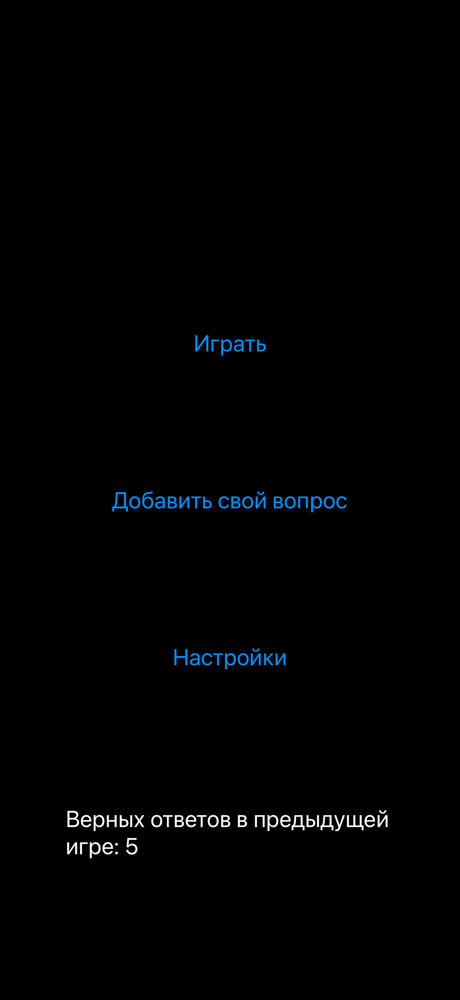
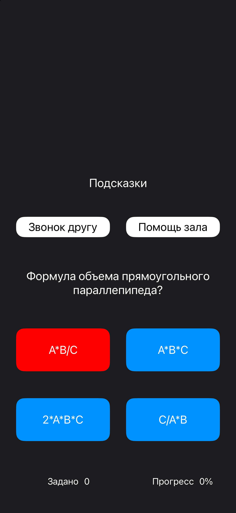
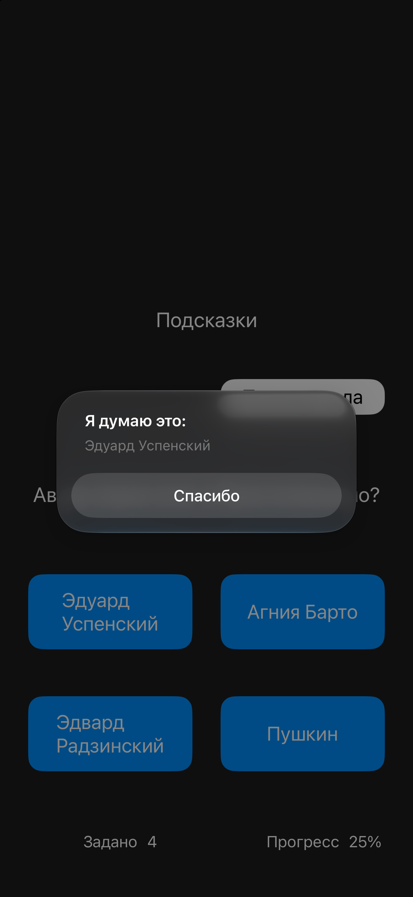
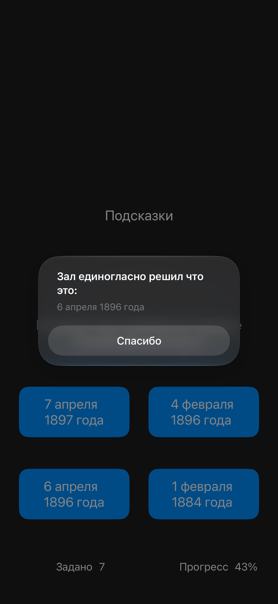
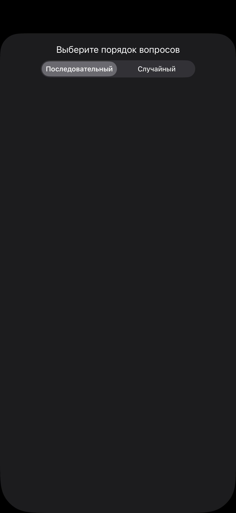

# Who Wants to Be a Millionaire

> **This project is no longer maintained.**
> It is kept as an educational subproject for reference and historical purposes.
> The code may be incomplete, outdated, or contain educational simplifications.

A quiz game inspired by the famous TV show **"Who Wants to Be a Millionaire?"**. Answer questions, climb the prize ladder, and use classic lifelines to help you reach the top.

## Screenshots

  <picture>
    <source media="(prefers-color-scheme: dark)" srcset="Screens/Screenshot_1_Dark.png">
    <source media="(prefers-color-scheme: light)" srcset="Screens/Screenshot_1_Light.png">
    
  </picture>
  &nbsp;&nbsp;&nbsp;
  <picture>
    <source media="(prefers-color-scheme: dark)" srcset="Screens/Screenshot_2_Dark.png">
    <source media="(prefers-color-scheme: light)" srcset="Screens/Screenshot_2_Light.png">
    
  </picture>
  &nbsp;&nbsp;&nbsp;
  <picture>
    <source media="(prefers-color-scheme: dark)" srcset="Screens/Screenshot_3_Dark.png">
    <source media="(prefers-color-scheme: light)" srcset="Screens/Screenshot_3_Light.png">
    
  </picture>

  <picture>
    <source media="(prefers-color-scheme: dark)" srcset="Screens/Screenshot_4_Dark.png">
    <source media="(prefers-color-scheme: light)" srcset="Screens/Screenshot_4_Light.png">
    
  </picture>
  &nbsp;&nbsp;&nbsp;
  <picture>
    <source media="(prefers-color-scheme: dark)" srcset="Screens/Screenshot_5_Dark.png">
    <source media="(prefers-color-scheme: light)" srcset="Screens/Screenshot_5_Light.png">
    
  </picture>
  &nbsp;&nbsp;&nbsp;
  <picture>
    <source media="(prefers-color-scheme: dark)" srcset="Screens/Screenshot_6_Dark.png">
    <source media="(prefers-color-scheme: light)" srcset="Screens/Screenshot_6_Light.png">
    
  </picture>

## Features

- 🎯 **Multiple-choice questions** with four answer options
- 🟢 **Correct answer** highlighted in green
- 🔴 **Wrong answer** highlighted in red
- 💰 **Prize ladder** — each correct answer increases your winnings
- 📞 **Phone a Friend** — call a virtual friend for a hint
- 👥 **Ask the Audience** — see how the audience would vote
- 🏁 **Game over** — the game ends on the first wrong answer

## Lifelines

| Lifeline | Description |
|----------|-------------|
| 📞 **Phone a Friend** | A virtual friend suggests the most likely answer |
| 👥 **Ask the Audience** | Shows a percentage distribution |

Each lifeline can be used **only once per game**.

## How the Game Works

1. The player starts at the first question of the prize ladder.
2. Four answer options are shown.
3. The player picks one answer.
4. After the choice:
   - the **correct answer is highlighted in green**;
   - if the player was wrong, the **chosen answer is highlighted in red**;
5. Correct answer → move up the ladder.
6. Wrong answer → the game ends and the player takes the last guaranteed prize.
7. The player can use lifelines at any moment before answering.

## Answer Highlighting

| Color | Meaning |
|-------|---------|
| 🟢 Green | The correct answer |
| 🔴 Red | The wrong answer chosen by the player |
| 🔵 Blue | Answer not selected |
